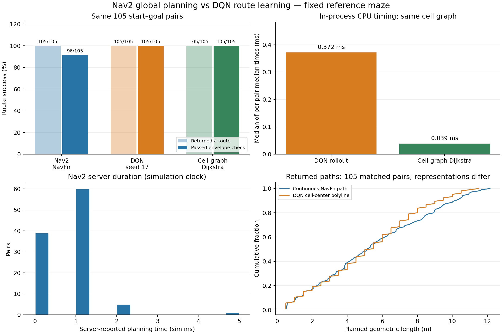
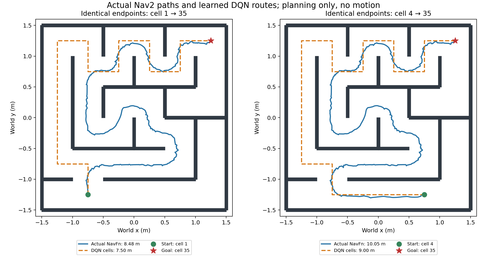
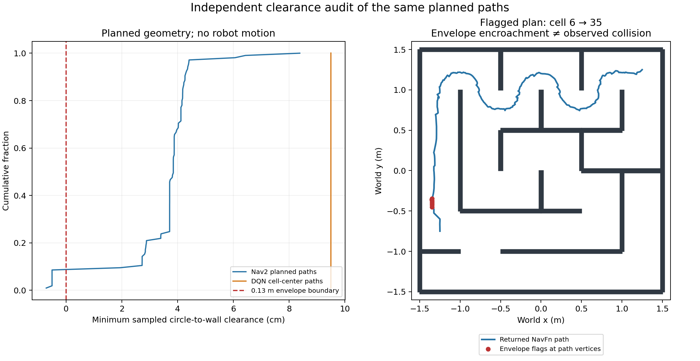

# Nav2 and Deep Q-learning evaluation

Generated from measured project results: 2026-10-17T12:58:48.410372+00:00.

## Findings

The actual Nav2 planner **returned 105/105 routes**;
**96/105 passed the independent 0.13 m envelope check**.
The deployed DQN produced **105/105 successful, envelope-checked routes**,
with **105/105 shortest cell-graph routes** and
**0 wall attempts**. Both were asked to plan between exactly
the same cell-center coordinates. This is a fixed-maze functional comparison.

**9 Nav2 paths were flagged for planned envelope clearance**,
even though their planning actions succeeded. These are conservative geometric
flags on planned paths, not observed robot collisions or failed driving trials.
The shared DWB controller can track a different trajectory from the global plan.

The in-process cell-graph Dijkstra reference is faster than DQN in these measurements.
The actual Nav2 planner is measured separately through ROS; its server duration
and action latency are not equivalent to an in-process Python CPU timer.
The historical driving trials do not support a robot-speed ranking because their
start and goal locations differ. DQN demonstrates learned route selection;
these results do not establish an advantage over classical planning.

## What is being compared

| Property | Nav2 classical navigation | Deep Q-learning navigation |
|---|---|---|
| Global route decision | `maze_navigation::MazeNavfnPlanner`, NavFn with Dijkstra (`use_astar: false`) | Reward-trained neural DQN, deployed seed 17 |
| Planning representation | 0.025 m costmap, continuous path coordinates | 6×6 cells, four adjacent-cell actions |
| Training | None | 2,000 offline grid episodes per seed; replay and target network |
| Local movement | DWB, velocity smoother, collision monitor | Same Nav2 components, learned waypoints via FollowPath and Spin |
| Learned inputs | Not applicable | Current/goal cell indicators, blocked neighbors, relative goal: 78 values |
| Goal set in this evaluation | Cells 4, 11, 35 | Same three trained goals |

DQN is a global route learner using Nav2 for local execution. It is not a complete
replacement for Nav2 and does not learn motor commands directly from LiDAR.
**Cell-graph Dijkstra is an additional reference, not a substitute for actual Nav2.**

## Matched planning experiment

The experiment requests each of 35 non-goal starting cells for each of three goals:
105 identical start–goal pairs. Nav2 uses `ComputePathToPose`, `use_start=true`,
planner `GridBased`, map-frame cell centers and yaw zero at both endpoints.
No robot motion actions are sent. The live map must match the DQN training world,
the planner must be active, and the expected NavFn Dijkstra plugin must be loaded.

Nav2 success requires action status 4, error code 0, a nonempty path, start and goal
errors at most 0.05 m, and nonnegative circle-to-wall clearance. Segment clearance
is sampled at intervals no larger than 0.0125 m with the same conservative 0.13 m
robot envelope. This is geometric checking, not a contact sensor.
DQN success uses the greedy learned policy with no search fallback or action masking.
Cell-graph optimality is checked against Dijkstra on the identical cell graph.
Continuous NavFn paths and cell-center polylines use different feasible path sets;
their geometric lengths are reported without treating their ratio as optimality.

| Metric | Measured result | Timing or representation scope |
|---|---:|---|
| Actual Nav2 returned routes | 105/105 | Action status 4, error 0, nonempty path |
| Actual Nav2 envelope-checked routes | 96/105 | Also requires endpoints and segment clearance |
| DQN successful routes | 105/105 | Greedy fixed-maze policy |
| Cell-graph Dijkstra routes | 105/105 | Separate discrete reference |
| DQN grid-optimal routes | 105/105 | Compared only with cell-graph Dijkstra |
| Nav2 planning median | 1.000 sim ms | Server node clock, one measured request per pair |
| Nav2 action round-trip median | 10.552 ms | Client wall clock, includes ROS transport/scheduling |
| DQN median route CPU time | 0.372 ms | Median of per-pair medians; 30 repeats |
| Cell-graph Dijkstra median CPU time | 0.039 ms | Same process and repeat count |

CPU timers exclude model loading, training, path-clearance checks and ROS.
DQN timing includes greedy rollout/transition bookkeeping; Dijkstra returns its
cell route. CPU pairs are shuffled with seed 123 and method order alternates.
Nav2 has three unmeasured warm-up requests. Nav2 costmaps remain live; before/after
hashes and update stamps are saved, rather than claiming a frozen costmap.
No confidence interval is inferred from repeated CPU timings or these dependent,
same-map pairs. Timing values can vary when the script is rerun.
Nav2 Jazzy computes `planning_time` from its node clock; in this project that uses
simulation time. It is not a wall-clock CPU benchmark.
[Planner-server source](https://api.nav2.org/nav2-jazzy/html/planner__server_8cpp_source.html).





## Independent planned-clearance flags

The evaluator preserves action success separately from its stricter circle-envelope
criterion. Negative values below are circle-to-wall distances, not body penetration
measurements. A 5 mm negative distance means the path center is 5 mm too close to
the SDF wall for the evaluator's 0.13 m enclosing circle. These plans were not driven
during this planning experiment. No collision count or safety superiority is inferred.

| Start cell | Goal cell | Action status / error | Minimum envelope clearance (mm) |
|---|---|---|---:|
| 12 | 4 | 4 / 0 | -5.00 |
| 18 | 4 | 4 / 0 | -5.00 |
| 24 | 4 | 4 / 0 | -5.00 |
| 30 | 4 | 4 / 0 | -5.00 |
| 12 | 11 | 4 / 0 | -5.00 |
| 18 | 11 | 4 / 0 | -5.00 |
| 24 | 11 | 4 / 0 | -5.00 |
| 30 | 11 | 4 / 0 | -5.00 |
| 6 | 35 | 4 / 0 | -7.09 |



## Training variation

| DQN seed | Episodes | Training time (s) | Successes | Held-out initial pairs |
|---|---:|---:|---:|---:|
| 7 | 2,000 | 21.1 | 102/105 | 18/21 |
| 17 (deployed) | 2,000 | 19.0 | 105/105 | 21/21 |
| 27 | 2,000 | 18.8 | 105/105 | 21/21 |

Seed 7's three failed pairs remain failures. The deployment checkpoint was chosen
after same-maze qualification; its held-out score is not an unbiased model-selection
estimate. Held-out pairs are excluded from training resets, but their states may
appear during episodes. This does not test unseen maps or new goals.

## Recorded Gazebo demonstrations

These four selected final demonstrations passed their respective action and
position/heading checks. They document execution, not a matched physical benchmark
or an overall success rate across development attempts. Earlier failures and
repairs remain in [the Nav2 report](../reports/TOP_RIGHT_REPAIR.md) and
[the DQN report](../reports/DQN_REPORT.md).

| Method | Actual start x,y (m) | Goal x,y (m) | Execution (s) | Gazebo position error (cm) | Minimum sampled clearance (cm) | Source |
|---|---|---|---:|---:|---:|---|
| Nav2 NavFn + DWB | (1.21, 1.23) | (-0.76, -1.25) | 88.8 | 7.8 | 6.7 | [JSON](../reports/top-right-return-trial.json) |
| Nav2 NavFn + DWB | (-0.75, -1.17) | (1.25, 1.25) | 83.5 | 4.7 | 6.6 | [JSON](../reports/top-right-full-route.json) |
| DQN + Nav2 DWB | (1.20, 1.21) | (0.75, -1.25) | 190.9 | 3.1 | 4.5 | [JSON](../reports/dqn-final-bottom.json) |
| DQN + Nav2 DWB | (0.72, -1.25) | (1.25, 1.25) | 226.9 | 6.7 | 5.6 | [JSON](../reports/dqn-final-top-right.json) |

Nav2 follows a continuous path; DQN stops/turns at learned waypoints. DQN also
temporarily uses an 8 cm intermediate waypoint tolerance, restoring the original
6 cm controller position tolerance for its destination and on exit. Its final
rotation is separate; independent end checks permit 9 cm map error, 12 cm Gazebo
error and 0.20 rad heading error. These execution-policy differences prevent
attributing historical timing differences solely to the global planner.

## Reproduce

From the workspace root, with the existing simulation and Nav2 running:

```bash
source scripts/dqn_env.bash
python evaluation/run_comparison.py --live-nav2
```

This collects planning results and regenerates all evaluation artifacts without
moving the robot or changing controller parameters. To regenerate from saved Nav2
plans without running ROS processes:

```bash
source scripts/dqn_env.bash
python evaluation/run_comparison.py
```

The second command re-times DQN/Dijkstra on this computer but retains the recorded
Nav2 capture time. `--repeats 30` controls CPU repeats per pair. The script exits
nonzero if either planner fails any pair; failed rows are retained in its outputs.
For this capture, exit code 1 is expected because nine plans fail the independent
envelope criterion; the report and all data are still generated successfully.

Check source hashes, saved geometry, row counts and metric consistency:

```bash
python evaluation/validate_results.py
python -m pytest evaluation/tests -q
```

The artifact audit checks consistency, rather than requiring every planner metric
to pass. [Audit result](results/validation.json), [nine regression checks](test_results.txt).

## Files and provenance

- [Machine-readable summary](results/comparison.json)
- [All 105 planning pairs](results/planning_trials.csv)
- [Actual Nav2 action results and paths](results/nav2_plans.json)
- [Raw repeated CPU timings](results/cpu_timings.json)
- [Three DQN seeds](results/dqn_seeds.csv)
- [Recorded Gazebo demonstration metrics](results/recorded_execution.csv)
- [Flagged Nav2 planned clearances](results/nav2_clearance_flags.csv)
- [Input checksums](results/source_manifest.json)
- Plot exports: `plots/*.png` and `plots/*.pdf`.

The reference maze, maps, checkpoint and controller configuration are unchanged by
this evaluation. The comparison covers this one known maze and three trained goals.
