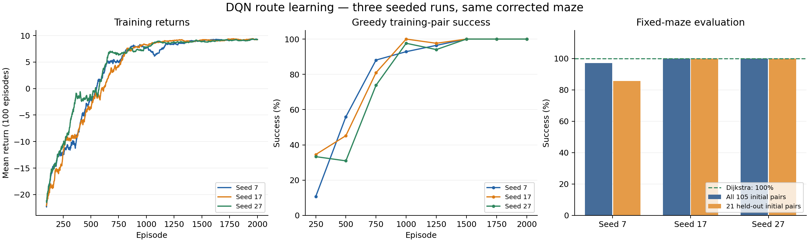
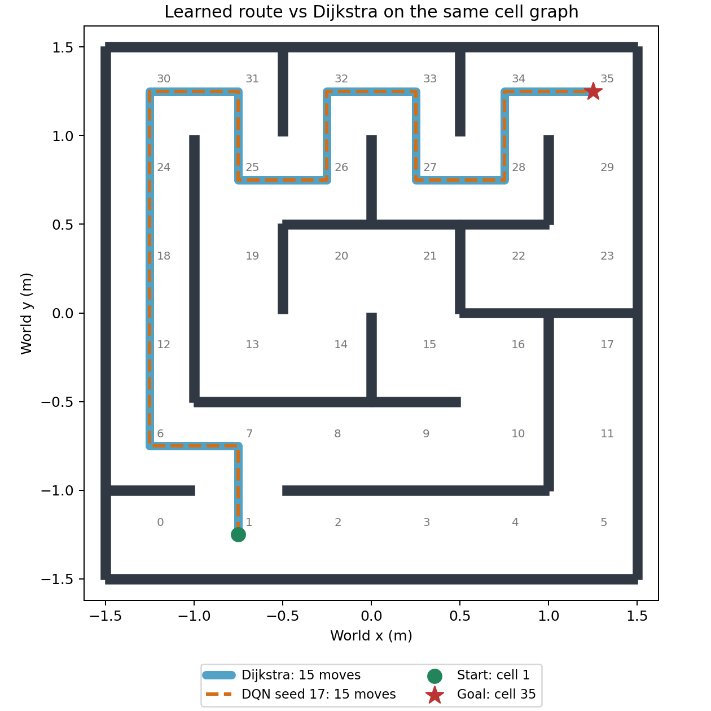
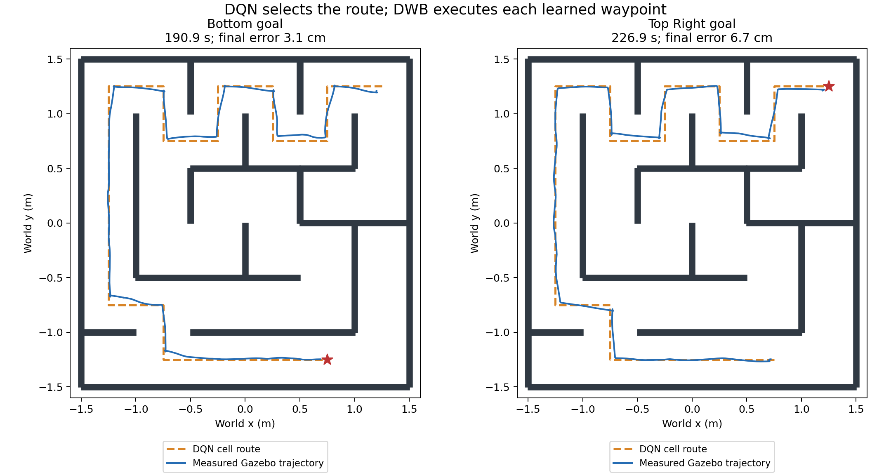

# Deep Q-learning implementation and measured results

Recorded 2026-10-17, Asia/Colombo. All robot tests use Gazebo Harmonic and ROS 2 Jazzy.

## Scope and implementation

The user selected **DQN route learning with Nav2 waypoint execution**. The former
`maze_dqn` files were empty and excluded from colcon. They are backed up in
`backups/2026-10-17-before-dqn/maze_dqn/`; the completed package is now enabled.

The agent is a genuine neural DQN, trained from transitions and rewards in a
fixed 6×6 cell MDP derived from the unchanged corrected SDF. The neural input is
78 values: current-cell one-hot, goal-cell one-hot, four blocked-neighbor flags
and relative goal coordinates. The network has two 128-unit ReLU hidden layers
and four Q outputs (east/north/west/south). Training uses uniform replay, Adam,
Huber loss, epsilon-greedy exploration, discount 0.98, and a frozen target network
copied every 250 optimizer updates. Batch size is 64; optimization occurs every
four transitions after a 512-transition warm-up. Time-limit truncations bootstrap;
true goal terminations do not.

Rewards are +10 at the goal, −1 for a wall attempt and −0.05 for other moves,
plus discounted Manhattan-distance potential shaping with terminal potential
zero. **Dijkstra is not used for action labels, rewards, replay or policy fallback.**
Blocked actions remain available during training and greedy evaluation.

During Gazebo execution, DQN selects the full cell sequence. The checked path
between consecutive learned waypoints is sent directly to **FollowPath/DWB**;
the classical NavFn global planner is bypassed. DWB, the velocity smoother and
collision monitor handle physical tracking. This is **not LiDAR-to-steering
learning**, and training episodes are **offline grid episodes**, not Gazebo episodes.

The implementation follows the standard replay/target-network DQN approach in
the [PyTorch DQN tutorial](https://docs.pytorch.org/tutorials/intermediate/reinforcement_q_learning).
[Software versions](dqn-software-versions.json), [isolated dependencies](../requirements-dqn.lock).

## Offline learning and comparison

The default three goals are cells 4, 11 and 35: `(0.75,-1.25)`, `(1.25,-0.75)`
and `(1.25,1.25)`. Each seeded run uses 84 training reset pairs and 21 held-out
initial pairs. The latter can occur as intermediate states during training, so
this is same-maze reset-pair evaluation, not unseen-state or unseen-map generalization.

| Seed | Episodes completed | Transitions | Training time | Greedy successes / 105 | Held-out initial successes / 21 | Optimal routes / 105 |
|---|---:|---:|---:|---:|---:|---:|
| 7 | 2,000 | 50,369 | 21.1 s | 102 | 18 | 102 |
| 17 | 2,000 | 49,175 | 19.0 s | 105 | 21 | 105 |
| 27 | 2,000 | 45,899 | 18.8 s | 105 | 21 | 105 |

Training ended after sustained perfect success on the training reset pairs.
Best checkpoint selection within each run uses training pairs only. Seed 7's
three failed held-out pairs were `(5,4)`, `(11,4)`, `(17,4)`; they looped without
wall attempts and remain recorded as failures. An untrained seed-7 neural network
solved only **2/105** pairs. No failed policy is replaced with a search result.

The deployment checkpoint `models/dqn/maze_dqn.pt` is seed 17's selected checkpoint
from episode 1,000. It was chosen after exhaustive same-maze functional qualification;
the deployment model's held-out score is therefore **not an unbiased held-out
model-selection estimate**. All three runs and the unsuccessful seed-7 pairs are
retained. [Aggregate metadata](dqn-experiment-summary.json), [model hashes](dqn-model-checksums.sha256).

Dijkstra solves 105/105 pairs on the **same cell graph**. Seed 17's mean CPU route
construction time was approximately **0.38 ms for DQN versus 0.033 ms for Dijkstra**,
excluding model load, training, ROS and physical motion. DQN is not faster in this
small maze. Both choose the 15-move, 7.5 m grid route from spawn cell 1 to cell 35.
Those grid lengths cannot be compared directly with continuous NavFn path lengths.

Evidence: [seed 7](dqn-seed7-evaluation.json), [seed 17](dqn-seed17-evaluation.json),
[seed 27](dqn-seed27-evaluation.json), [untrained control](dqn-untrained-evaluation.json).
Raw CSV, configuration and training summaries are in `reports/dqn-training/`.

## Runtime checks and limitations

The execution client checks the live map against the corrected geometry, active
AMCL/controller/behavior/velocity-smoother/collision-monitor states, sensor freshness,
TwistStamped commands, unique project nodes, competing actions and localization
agreement with named Gazebo `burger` poses. During motion it cancels for stale
ground truth, localization divergence, timeout or crossing a 0.13 m enclosing-circle
wall-clearance envelope. This is sampled geometry checking, not a contact sensor.

The interruption test passed: SIGINT after an accepted FollowPath goal produced
canceled status 5 and zero final linear/angular velocity, with positive clearance.
[Cancellation evidence](dqn-cancellation-verification.json). A competing client
was rejected by the project DQN lock. [Guard result](dqn-overlap-guard.json).

One later startup check stopped before motion when the controller service was
not discovered within the original five-second wait, although the project node
was running and active. The client now warms up DDS/TF/sensors first and allows
15 seconds for each lifecycle-service discovery. The failed startup is retained:
[discovery result](dqn-startup-discovery-failed.json).

Sending the entire cell polyline as one FollowPath goal stalled near a sharp
corner; the action aborted with error 105 and no clearance violation. This failed
attempt is preserved: [continuous-path failure](dqn-continuous-path-failed.json).
The implementation now visits learned waypoints individually. One subsequent
route completed all 11 targets to bottom cell 4 in **119.6 s**, finishing **4.4 cm**
from the Gazebo target, minimum sampled circle-to-wall clearance **5.4 cm** and zero
final command. [Bottom route](dqn-gazebo-bottom.json).

An initial longer waypoint trial reached three targets but lost progress while
finishing the fourth turn, at 6.4 cm estimated position error, just outside the
6 cm final-goal threshold. [Preserved failed trial](dqn-waypoint-turn-failed.json).
Intermediate DQN waypoints now temporarily use an 8 cm position acceptance radius;
the original final-goal tolerance is restored for the last target and in cleanup.
Speed limits, robot radius, inflation and final position/heading verification
remain unchanged. The runtime report records successful parameter restoration.

With this correction, a 15-waypoint continuation to the top-right cell completed
in **160.8 s**, finishing **5.4 cm** from the target with minimum sampled clearance
**5.0 cm**. Final FollowPath status was 4/error 0, final commands were zero, and
the original 0.06 m controller tolerance was restored. [Corrected continuation](dqn-gazebo-top-right-continuation.json).
This began near cell 7 after the failed turn trial; it is not a fresh full route
from the default spawn. A later return check stopped after eight successful action
results because one intermediate heading settled at 0.203 rad error, just beyond
the verifier's original 0.20 rad cutoff. [Preserved verification stop](dqn-intermediate-heading-verification-failed.json).
The final verifier allows 0.30 rad at intermediate targets, whose headings guide
the next leg, while retaining 0.20 rad at the final goal. Position checks and
collision margins were not relaxed.

A subsequent route reversal exposed a short-path tracking failure: DWB moved away
from the path during a U-turn and returned error 103 when its pruned path became
empty. [Preserved reversal failure](dqn-initial-reversal-failed.json). The client now
aligns with the next learned edge using Nav2's collision-checked Spin action before
FollowPath if the heading difference exceeds 0.4 rad. The same freshness,
localization, clearance, timeout and interruption monitoring applies during spins.

The first corrected reversal trial passed 18 targets but failed the last
FollowPath action during its arrival turn (error 105). It ended 6.4 cm from the
physical target; the verifier correctly retained a failed result.
[Final-heading failure](dqn-final-heading-failed.json). Final translation and
orientation now use separate FollowPath and Spin actions. The original 6 cm
controller position tolerance remains in effect at the final target. A regression
test confirms that a failed final rotation cannot become a successful route result.
No claim of reliability on every continuous start pose, dynamic obstacles, new
maps or hardware is made.

## Final Gazebo validation

Consecutive final trials drove from the existing top-right pose to bottom cell 4,
then back to cell 35. These are complete learned routes from the live poses,
not fresh default-spawn trials. Each policy selected 18 moves, a 9.0 m cell route.
Every FollowPath action and every required Spin action returned status 4/error 0.
Both runs ended with zero commands and acknowledged controller-parameter restoration.
An independent [final parameter readback](dqn-final-controller-parameters.json)
confirmed 0.06 m position tolerance, 0.12 rad yaw tolerance, 0.10 m/s translation
and 0.65 rad/s rotation limits.

| Goal | Cells | Learned moves | Waypoints completed | Wall time (s) | Gazebo error (cm) | Map error (cm) | Minimum circle clearance (cm) |
|---|---|---:|---:|---:|---:|---:|---:|
| [Bottom](dqn-final-bottom.json) | 35 → 4 | 18 | 18/18 | 190.9 | 3.1 | 3.4 | 4.5 |
| [Top-right](dqn-final-top-right.json) | 4 → 35 | 18 | 18/18 | 226.9 | 6.7 | 8.3 | 5.6 |

The final top-right heading error was 0.016 rad. Its final approach met the
controller's 0.06 m position threshold before the separate arrival rotation;
post-rotation errors are shown in the table. Independent end checks require
less than 0.09 m map error, 0.12 m Gazebo error and 0.20 rad heading error.
These simulator times include stops and turns at learned waypoints and are not
a matched physical timing comparison against continuous NavFn navigation.
[Compact execution evidence](dqn-final-execution-summary.json).

## Build, tests and preservation

The package builds with colcon using the isolated CPU PyTorch environment. Existing
Nav2 checks and DQN tests passed: [34 checks](dqn-all-package-test-result.txt).
DQN tests cover geometry, collision rewards, Bellman targets, replay wrapping,
neural/target updates, checkpoint round trips, failed-policy handling, split
reproducibility, path clearance, map mismatch, mid-edge connection behavior,
temporary waypoint-tolerance preservation/restoration and failed final rotation.

The original corrected/reference maze, map and SLAM configuration checksums passed:
[preservation check](dqn-navigation-preservation.txt). Original empty DQN files were
also preserved in backups: [stub checksums](dqn-original-stubs-preservation.txt).
[Static audit](dqn-static-audit.json). No `/opt/ros/jazzy` files were modified.

See [exact setup, training and driving commands](../src/maze_dqn/README.md).
